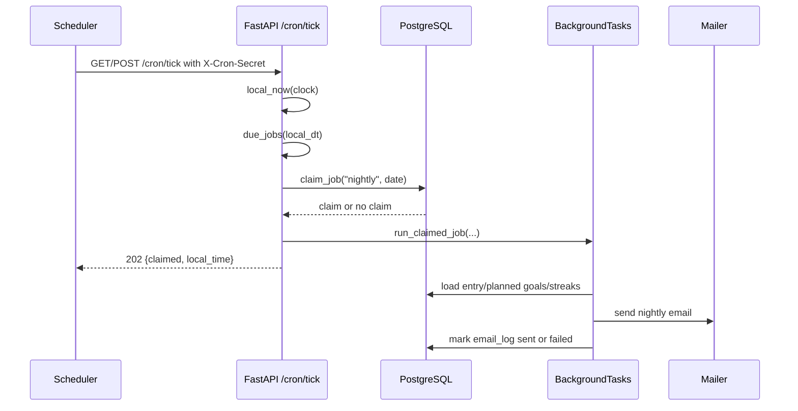
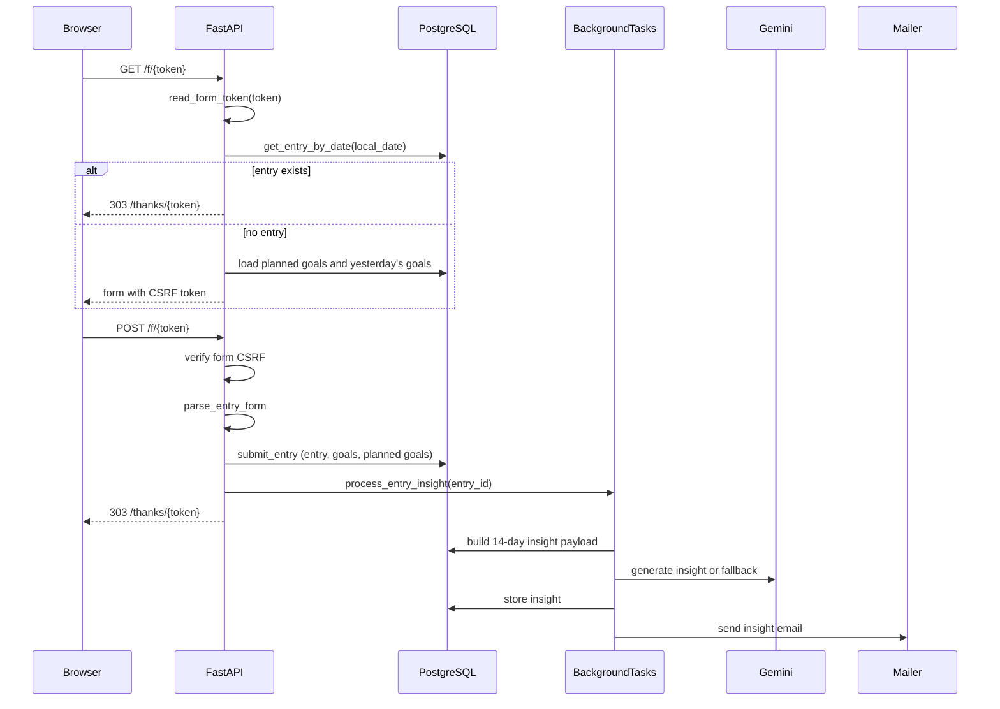
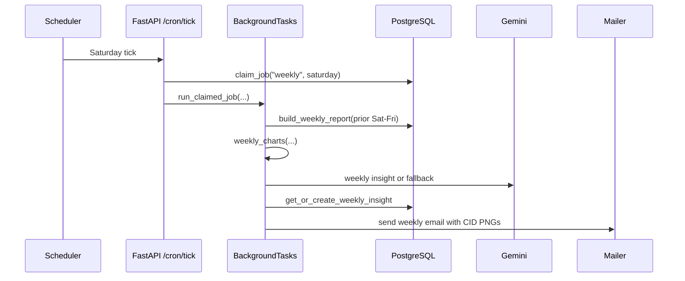

# Architecture

Purpose: Explain the runtime shape of Nightly Journal and how the current code handles check-ins, scheduled email, insights, and weekly reports.

Last verified: 2026-10-23

## Current state

Nightly Journal is a single-user, server-rendered FastAPI application. It runs as one Render web service, stores data in PostgreSQL (Neon in the reference deployment), and relies on an external scheduler to call `GET` or `POST /cron/tick`.

There is no separate worker, queue, dashboard, login, or in-process scheduler. Email work is claimed in the database first, then handed to FastAPI `BackgroundTasks` after the tick or form response.

```mermaid
flowchart LR
  Cron[cron-job.org or other scheduler] -->|GET/POST /cron/tick<br/>X-Cron-Secret| App[FastAPI app]
  Browser[Browser] -->|GET/POST /f/{token}| App
  Browser -->|GET /thanks/{token}| App
  Browser -->|GET /| App
  App -->|SQLAlchemy| DB[(PostgreSQL / Neon)]
  App -->|SMTP 2525 or HTTPS| Mail[Brevo SMTP or Resend]
  App -->|HTTPS| Gemini[Gemini API optional]
  App -->|matplotlib PNGs| Mail
  App -->|BackgroundTasks| App
  App -->|GET /healthz| Health[Liveness only]
```

## Components

| Component | Responsibility | Current implementation |
| --- | --- | --- |
| HTTP application | Routing, forms, health, cron entry point | `app/main.py`, `app/routes/` |
| Configuration | Environment loading and production validation | `app/config.py` |
| Persistence | SQLAlchemy engine/session and ORM models | `app/db.py`, `app/models.py` |
| Scheduling decisions | Decide which jobs are due in Nepal time | `app/scheduler.py` |
| Job claiming and delivery state | Lease, retry, and sent/failed bookkeeping | `app/jobs.py` |
| Entry submission | Validate and persist entries, goals, and next-day plans | `app/forms.py`, `app/schemas.py`, `app/services/entries.py` |
| Nightly insight | Build a 14-day payload, call Gemini or fallback, store result | `app/insights.py`, `app/gemini.py` |
| Weekly report | Build prior-Saturday-to-Friday report and four charts | `app/weekly.py`, `app/charts.py` |
| Email composition | Render nightly, insight, and weekly messages | `app/email_builder.py`, `app/templates/email/` |
| Email delivery | SMTP and Resend adapters behind a protocol | `app/mailer.py` |
| CLI operations | Test email and optional IMAP inbox check | `app/cli.py` |
| Schema management | Alembic migration | `alembic/versions/9e95400cf356_initial_schema.py` |

## Request flows

### Nightly tick



- The nightly window is `21:00 <= local time < 23:00` in `Asia/Kathmandu`.
- A tick outside the window claims nothing and returns `202`.
- A wrong or missing `x-cron-secret` returns `403`.
- `claim_job` inserts an `email_log` row or reclaims a failed/expired lease.
- Delivery runs after the response is returned. A crash after the mailer accepts a message but before `sent` is committed can lead to a duplicate on retry; see [Scheduling](./scheduling.md).

### Check-in form



- The form token is a signed date, not a database session. It is valid for `FORM_TOKEN_MAX_AGE_SECONDS` (default 48 hours).
- The form CSRF token is signed with a separate secret and bound to the same local date.
- A duplicate POST returns the existing entry without overwriting it.
- The insight is generated only when a new entry is created. If insight email delivery fails, the insight remains stored, but the `insight` email job has no scheduler retry path: `/cron/tick` only handles `nightly` and `weekly`. This is a known limitation; see [Scheduling](./scheduling.md).

### Weekly report



- The weekly window is Saturday `06:00 <= local time < 12:00` in `Asia/Kathmandu`.
- The report range is the previous Saturday through the Friday before the current Saturday.
- The weekly insight is persisted as `insights.kind = "weekly"` with the report `start_date` and `end_date`.
- The email contains four inline PNGs: completion, sleep timing, screen time, and mood.

### Dashboard flow

The dashboard is **not implemented**. `GET /` renders `app/templates/home.html`, which states that the private dashboard is not part of this build. Email templates link to `PUBLIC_BASE_URL + "/"`, so those links currently land on the placeholder page.

There is no login, session cookie, password check, login throttle, dashboard history, heatmap, or Chart.js bundle in the current code. Those remain milestone 6 work; see [Roadmap](./roadmap.md).

## Module map

| Path | Role |
| --- | --- |
| `app/main.py` | App factory, dependency injection, static files, security headers, routers |
| `app/config.py` | `Settings`, `.env` loading, production secret and HTTPS validation |
| `app/db.py` | SQLite/PostgreSQL engine settings, session factory, naming convention |
| `app/models.py` | `Entry`, `Goal`, `PlannedGoal`, `Insight`, `EmailLog` |
| `app/timeutils.py` | Nepal timezone conversion, local date, sleep-duration and chart-axis helpers |
| `app/scheduler.py` | Nightly/weekly due-window decisions |
| `app/streaks.py` | Day status, current/longest streaks, range statuses |
| `app/stats.py` | Gap-filled daily metrics and range summaries |
| `app/tokens.py` | Signed form and CSRF tokens |
| `app/forms.py` | HTML form parsing and friendly validation errors |
| `app/schemas.py` | Pydantic input and AI output schemas |
| `app/services/entries.py` | Entry persistence, planned goals, metrics, streak queries |
| `app/insights.py` | Nightly insight payload, persistence, and email orchestration |
| `app/gemini.py` | Gemini HTTP client, strict output schema, rule-based fallback |
| `app/weekly.py` | Weekly report, goal highlights, weekly insight, template context |
| `app/charts.py` | Four matplotlib PNG charts with alt text and CIDs |
| `app/email_builder.py` | Nightly, insight, and weekly `OutboundEmail` builders |
| `app/mailer.py` | `Mailer` protocol, SMTP and Resend adapters, MIME/CID handling |
| `app/jobs.py` | `claim_job`, `run_claimed_job`, retry/backoff, sent/failed transitions |
| `app/cli.py` | `send-test-email` and optional IMAP delivery check |
| `app/routes/` | `home`, `health`, `form`, `thanks`, `cron` |
| `app/templates/` | HTML pages and email templates |
| `app/static/` | Local CSS and form JavaScript |
| `alembic/` | Migration environment and initial schema |
| `tests/` | Unit, integration, migration, and route tests |

## Runtime constraints

- Render Free web services have 0.1 CPU and 512 MB RAM in the reference plan.
- Render Free blocks outbound TCP `25`, `465`, and `587`; this is why the approved SMTP path uses Brevo on port `2525`.
- Render Free spins down after 15 minutes without inbound traffic and takes about a minute to spin back up.
- The filesystem is ephemeral. The SQLite file is for local development only; production data belongs in PostgreSQL.
- The app uses a small SQLAlchemy pool (`pool_size=2`, `max_overflow=2`, `pool_recycle=300`, `pool_pre_ping=True`, `connect_timeout=10`).
- `/healthz` is a liveness endpoint only. It does not query the database.

## Deliberately not built

- Dashboard, password login, sessions, login throttling, heatmap, history pages.
- Gmail API/OAuth adapter. The current mail transports are SMTP and Resend.
- Dockerfile.
- Weekly report preview CLI.
- Editing or deleting a submitted entry.
- Multi-user support, timezone selection, or a database-backed job queue.

## Related docs

- [Data model](./data-model.md)
- [Scheduling and idempotency](./scheduling.md)
- [Streaks and statuses](./streaks-and-status.md)
- [Email](./email.md)
- [Security](./security.md)
- [Deployment](./deployment.md)
