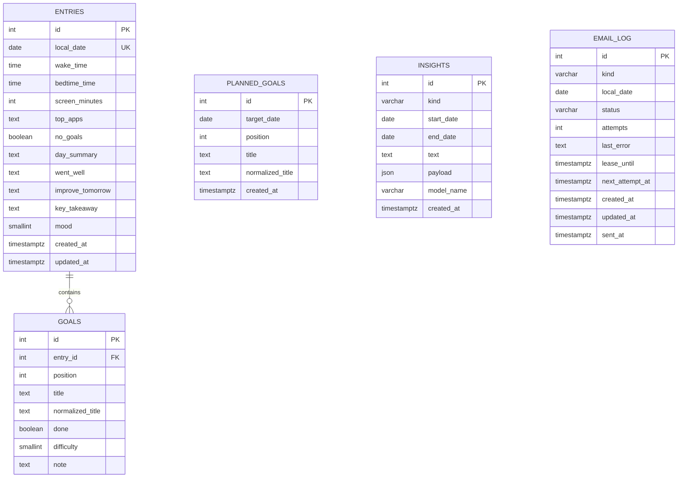

# Data model

Purpose: Document the persistent schema, constraints, relationships, and time conventions used by Nightly Journal.

Last verified: 2026-10-23

## Entity relationship diagram

`PLANNED_GOALS`, `INSIGHTS`, and `EMAIL_LOG` are not linked by foreign keys to `ENTRIES`. They are keyed by local date or by a date range instead.

## `entries`

One row per local date. The unique constraint on `local_date` prevents two check-ins for the same day.

| Column | Type | Null | Default / notes |
| --- | --- | --- | --- |
| `id` | `INTEGER` | no | Primary key |
| `local_date` | `DATE` | no | Unique; Nepal local calendar date |
| `wake_time` | `TIME` | no | Local wall-clock time |
| `bedtime_time` | `TIME` | no | Local wall-clock time |
| `screen_minutes` | `INTEGER` | no | Check: `0..1440` |
| `top_apps` | `TEXT` | yes | Optional free text, maximum 200 characters at input validation |
| `no_goals` | `BOOLEAN` | no | Default `false`; true means a logged day with no goals |
| `day_summary` | `TEXT` | no | Required text |
| `went_well` | `TEXT` | no | Required text |
| `improve_tomorrow` | `TEXT` | no | Required text |
| `key_takeaway` | `TEXT` | no | Required text |
| `mood` | `SMALLINT` | no | Check: `1..5` |
| `created_at` | `TIMESTAMPTZ` | no | `utc_now()` in Python and `CURRENT_TIMESTAMP` in the database |
| `updated_at` | `TIMESTAMPTZ` | no | Updated by SQLAlchemy `onupdate=utc_now` |

Constraints:

- `ck_entries_screen_minutes_range`: `screen_minutes BETWEEN 0 AND 1440`
- `ck_entries_mood_range`: `mood BETWEEN 1 AND 5`
- `uq_entries_local_date`: unique `local_date`

Relationship:

- `Entry.goals` is ordered by `Goal.position`, cascades `all, delete-orphan`, and uses `passive_deletes=True`.
- Deleting an entry deletes its goals through the database `ON DELETE CASCADE` and ORM cascade.

## `goals`

Goals belong to one entry. Positions are zero-based and define display order.

| Column | Type | Null | Default / notes |
| --- | --- | --- | --- |
| `id` | `INTEGER` | no | Primary key |
| `entry_id` | `INTEGER` | no | FK `entries.id`, `ON DELETE CASCADE`, indexed |
| `position` | `INTEGER` | no | Check: `>= 0`; unique with `entry_id` |
| `title` | `TEXT` | no | Display title; stripped by the validator |
| `normalized_title` | `TEXT` | no | Analytics key; indexed; non-blank check |
| `done` | `BOOLEAN` | no | Default `false` |
| `difficulty` | `SMALLINT` | no | Check: `1..5` |
| `note` | `TEXT` | no | Required text |

Constraints and indexes:

- `uq_goals_entry_position`: unique `(entry_id, position)`
- `ck_goals_position_non_negative`: `position >= 0`
- `ck_goals_difficulty_range`: `difficulty BETWEEN 1 AND 5`
- `ck_goals_title_not_blank`: `length(trim(title)) > 0`
- `ck_goals_normalized_title_not_blank`: `length(normalized_title) > 0`
- `ix_goals_entry_id`
- `ix_goals_normalized_title`

The `title` validator calls `normalize_goal_title()` and stores the result in `normalized_title`. The displayed title keeps its original spacing after trimming.

## `planned_goals`

Tomorrow's plans are stored separately from completed entries. They are consumed when the next form is opened and are not a promise that the goal will be completed.

| Column | Type | Null | Default / notes |
| --- | --- | --- | --- |
| `id` | `INTEGER` | no | Primary key |
| `target_date` | `DATE` | no | Indexed; the day the plan is for |
| `position` | `INTEGER` | no | Check: `>= 0`; unique with `target_date` |
| `title` | `TEXT` | no | Display title |
| `normalized_title` | `TEXT` | no | Analytics key; indexed |
| `created_at` | `TIMESTAMPTZ` | no | `utc_now()` / `CURRENT_TIMESTAMP` |

Constraints and indexes:

- `uq_planned_goals_target_position`: unique `(target_date, position)`
- `ck_planned_goals_position_non_negative`
- `ck_planned_goals_title_not_blank`
- `ck_planned_goals_normalized_title_not_blank`
- `ix_planned_goals_target_date`
- `ix_planned_goals_normalized_title`

When an entry is submitted, plans for the submitted date are deleted. Plans for the next date are replaced only if no entry exists for that next date. This avoids overwriting plans after the next day has already been logged.

## `insights`

Stores both nightly and weekly generated/fallback insights.

| Column | Type | Null | Default / notes |
| --- | --- | --- | --- |
| `id` | `INTEGER` | no | Primary key |
| `kind` | `VARCHAR(16)` | no | Check: `nightly` or `weekly` |
| `start_date` | `DATE` | no | Nightly: the entry date; weekly: prior Saturday |
| `end_date` | `DATE` | no | Nightly: same as start; weekly: Friday |
| `text` | `TEXT` | no | `summary` from the validated AI output |
| `payload` | `JSON` | yes | Full validated `InsightOutput` model dump |
| `model_name` | `VARCHAR(100)` | no | Gemini model name or `rule-based` |
| `created_at` | `TIMESTAMPTZ` | no | `utc_now()` / `CURRENT_TIMESTAMP` |

Constraints:

- `uq_insights_kind_start_end`: unique `(kind, start_date, end_date)`
- `ck_insights_kind_valid`: `kind IN ('nightly', 'weekly')`
- `ck_insights_date_range_valid`: `end_date >= start_date`

`payload` uses SQLAlchemy `JSON`, not PostgreSQL `JSONB`. It contains the structured insight fields (`summary`, `wins`, `struggles`, `actions`, `pattern`). It does not contain the raw prompt or API key.

## `email_log`

Tracks one deliverable per `(kind, local_date)`. It is both the idempotency key and the retry state.

| Column | Type | Null | Default / notes |
| --- | --- | --- | --- |
| `id` | `INTEGER` | no | Primary key |
| `kind` | `VARCHAR(16)` | no | Check: `nightly`, `weekly`, or `insight` |
| `local_date` | `DATE` | no | Local date the delivery belongs to |
| `status` | `VARCHAR(16)` | no | Check: `sending`, `sent`, or `failed` |
| `attempts` | `INTEGER` | no | Check: `>= 0`; incremented on each claim |
| `last_error` | `TEXT` | yes | Safe error text, truncated to 500 characters |
| `lease_until` | `TIMESTAMPTZ` | yes | Set to `now + 5 minutes` on claim |
| `next_attempt_at` | `TIMESTAMPTZ` | yes | Backoff gate for failed jobs |
| `created_at` | `TIMESTAMPTZ` | no | `utc_now()` / `CURRENT_TIMESTAMP` |
| `updated_at` | `TIMESTAMPTZ` | no | Updated by SQLAlchemy `onupdate=utc_now` |
| `sent_at` | `TIMESTAMPTZ` | yes | Set when delivery succeeds |

Constraints and indexes:

- `uq_email_log_kind_local_date`: unique `(kind, local_date)`
- `ck_email_log_kind_valid`
- `ck_email_log_status_valid`
- `ck_email_log_attempts_non_negative`
- `ix_email_log_status_next_attempt_at`: `(status, next_attempt_at)`

State transitions and retry rules are documented in [Scheduling](./scheduling.md).

## Time conventions

- `local_date` is the date in `Asia/Kathmandu`, not UTC.
- `created_at`, `updated_at`, `lease_until`, `next_attempt_at`, and `sent_at` are timezone-aware timestamps stored in UTC.
- `wake_time` and `bedtime_time` are local wall-clock values with no timezone.
- Sleep duration is `(wake - bed) mod 24h` in minutes via `sleep_duration_minutes()`.
- The sleep chart uses `minutes_after_18()`: minutes after 18:00, wrapping at midnight, so evening and early-morning values form one continuous axis.

## Goal-title normalization

`normalize_goal_title()` applies:

1. Unicode NFKC normalization.
2. Leading/trailing whitespace removal.
3. Internal whitespace collapse to one space.
4. Case folding.
5. Removal of trailing `.`, `!`, `?`, `;`, `:`, or `,`.
6. Final trim.

The normalized value is used for grouping and analytics. It is not shown in place of the user's title.

## Related docs

- [Architecture](./architecture.md)
- [Scheduling and idempotency](./scheduling.md)
- [Streaks and statuses](./streaks-and-status.md)
- [AI insights](./ai-insights.md)
