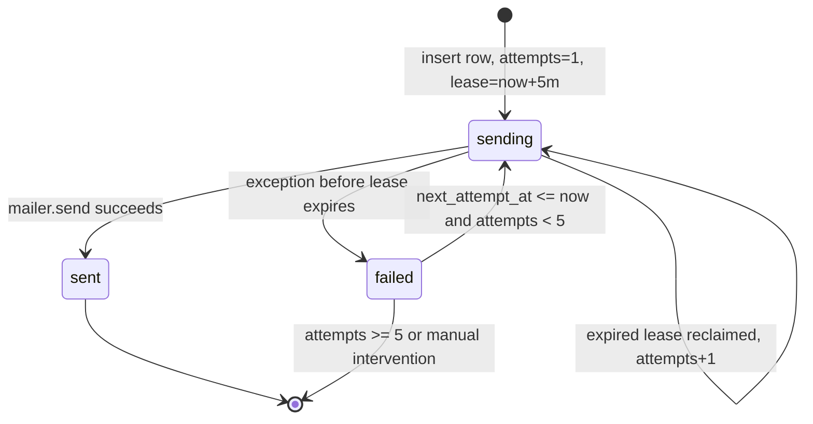

# Scheduling and idempotency

Purpose: Explain when nightly and weekly jobs run, how ticks claim work, and how delivery avoids duplicates and retries failures.

Last verified: 2026-10-23

## Windows

All windows are evaluated in `Asia/Kathmandu` using the app clock, which defaults to `utc_now()` and is converted by `local_now()`.

| Job | Local window | Due date | Code |
| --- | --- | --- | --- |
| Nightly | `21:00 <= time < 23:00` | Current local date | `due_nightly()` |
| Weekly | Saturday `06:00 <= time < 12:00` | Current Saturday | `due_weekly()` |

`due_jobs()` returns zero, one, or two `DueJob` values. A Saturday evening tick can therefore be a nightly tick; a Saturday morning tick is only weekly.

The external scheduler should tick more often than the window:

| Job | Suggested schedule | Why |
| --- | --- | --- |
| Nightly | Every 5 minutes from 20:40 through 23:00 NPT | Covers cold starts and clock drift while the window is open |
| Weekly | Every 5 minutes Saturday 05:40 through 12:00 NPT | Covers the six-hour weekly window |
| Warm-up | `GET /healthz` shortly before each window | Reduces the chance that the first tick is consumed by a Render cold start |

A Render Free service can take about a minute to wake. cron-job.org closes a request after 30 seconds by default. The tick claims work and returns `202` before the background task finishes, but a cold start can still exceed the scheduler timeout before the response starts. A warm-up request or a scheduler with a longer timeout avoids that failure mode.

## Tick endpoint

`GET` and `POST /cron/tick` require:

```http
X-Cron-Secret: <CRON_SECRET>
```

The comparison uses `secrets.compare_digest`. A wrong or missing header returns:

```json
{"detail": "forbidden"}
```

with status `403`.

A successful tick returns status `202`:

```json
{
  "claimed": [
    {"kind": "nightly", "local_date": "2026-10-23", "attempts": 1}
  ],
  "local_time": "2026-10-23T21:05:00+05:45"
}
```

If nothing is due, `claimed` is empty.

## Claim state machine

`email_log` is the idempotency mechanism. The unique key is `(kind, local_date)`.



### First claim

`claim_job()` tries to insert:

- `kind`
- `local_date`
- `status = "sending"`
- `attempts = 1`
- `lease_until = now + 5 minutes`

The unique constraint makes this safe when two ticks overlap. If the insert succeeds, the job is claimed and the tick schedules the background task.

### Reclaim

If the insert hits the unique constraint, `claim_job()` attempts an update only when all of these are true:

- `attempts < 5`
- status is `failed`, or status is `sending` with an expired lease
- `next_attempt_at` is null or already due

The update sets `status = "sending"`, increments `attempts`, sets a new five-minute lease, clears `next_attempt_at` and `last_error`, and clears `sent_at`.

Only the transaction that updates exactly one row gets the claim. Other concurrent ticks return no claim.

## Delivery and retry

`run_claimed_job()` rechecks that the row is still `sending`, builds the message, and calls the mailer.

On success:

- `status = "sent"`
- `sent_at = now`
- `lease_until = NULL`
- `next_attempt_at = NULL`
- `last_error = NULL`

On failure:

- `status = "failed"`
- `lease_until = NULL`
- `last_error` is the mailer error text, or the exception class name for unexpected errors
- `next_attempt_at` is `now + min(2 ** (attempts - 1), 30) minutes`
- If the exception is `MailerAuthError`, `next_attempt_at` is `now + 1 day`

Examples:

| Attempts | Backoff after failure |
| --- | --- |
| 1 | 1 minute |
| 2 | 2 minutes |
| 3 | 4 minutes |
| 4 | 8 minutes |
| 5 | 16 minutes, but no further claim because `attempts < 5` fails |

The fifth failed attempt remains `failed`. There is no admin UI or automatic reset after five attempts. Manual recovery is covered in [Runbook](./runbook.md).

## At-least-once caveat

This is an at-least-once design, not exactly-once.

If the mailer accepts the message and the process crashes before the `sent` commit, the row remains `sending`. After the five-minute lease expires, a later tick can reclaim and send again. A duplicate is preferable to a missing nightly or weekly email for this single-user app.

This retry path applies to `nightly` and `weekly` only. The `insight` email is attempted once immediately after entry submission. If it fails, the row is marked `failed`, but `/cron/tick` does not claim `insight` jobs, and a duplicate form submission does not re-trigger it. The stored insight remains available on `/thanks/{token}`; there is no automatic retry.

## Nightly job

`run_claimed_job(..., kind="nightly", ...)`:

1. Loads the entry context for the local date.
2. Builds the nightly email with:
   - Form link and dashboard link.
   - Planned goals for the day.
   - Yesterday's insight headline or key takeaway.
   - Current goal streak.
3. Sends the message.
4. Marks the `nightly` row sent or failed.

The nightly email can be sent even if there is no entry for the day. It is a reminder, not a report.

## Weekly job

`run_claimed_job(..., kind="weekly", ...)`:

1. Computes the prior Saturday through Friday range with `weekly_range(saturday)`.
2. Builds range stats and streaks for that range.
3. Finds the easiest and hardest goal in the range. Ties use the most recent `(local_date, position)`.
4. Generates four charts.
5. Gets or creates the weekly insight for the same range.
6. Renders and sends the weekly email with inline PNGs.
7. Marks the `weekly` row sent or failed.

If weekly insight generation or chart rendering fails, the whole job fails and is retried. If the insight was already stored before a later failure, the retry reuses it.

## Insight job

The insight email is not scheduled by a time window. It is triggered after a new entry is submitted:

1. `process_entry_insight(entry_id, ...)` loads the entry.
2. `get_or_create_nightly_insight()` builds a 14-day payload and stores the result.
3. `claim_job(session, "insight", local_date, now)` claims the insight delivery.
4. The email is sent and marked sent or failed.

If the form is submitted twice, the duplicate submission returns the existing entry and does not schedule a second insight task. A failed `insight` row is not retried by `/cron/tick`; `run_claimed_job()` supports only `nightly` and `weekly`. This is a current limitation, not an exactly-once guarantee.

## Test-email command

`python -m app.cli send-test-email` sends a nightly-style message with a unique subject:

```text
Nightly Journal test <UTC timestamp>
```

It prints:

- `relay_accepted` when the mailer accepts the message.
- `checking inbox...` when `IMAP_HOST` and `IMAP_USER` are configured.
- `delivered_to_inbox` if the subject is found within 90 seconds.
- `not_found` if polling times out or IMAP is unavailable.
- `send_failed: <safe error>` on a mailer failure.

The test command does not create an `email_log` row and does not affect scheduled delivery.

## Related docs

- [Architecture](./architecture.md)
- [Data model](./data-model.md)
- [Email](./email.md)
- [Deployment](./deployment.md)
- [Runbook](./runbook.md)
